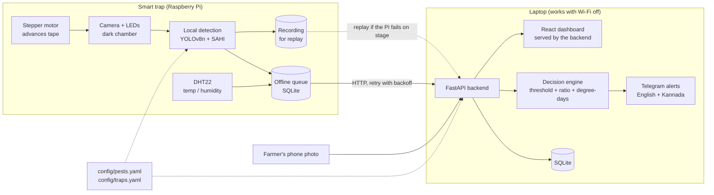

# KeetaSense - AI insect counting and pest monitoring

*Chip to Crop hackathon (Presidency University × ICAR-IIHR) - Problem Statement 1:
AI-Based Insect Counting and Pest Monitoring System.*

A smart yellow sticky trap that photographs a fresh piece of sticky tape every day,
counts **pests** (whitefly) and **beneficial predators** (Macrolophus, Nesidiocoris)
with AI, combines the counts with temperature (degree-days), and tells the farmer
one thing per trap: **SPRAY**, **RELEASE BIOCONTROL** or **WAIT** - with a plain-language
reason, in English and Kannada.

> **Status:** the software runs end to end on a laptop, with mock hardware and simulated
> data, and is ready to switch to the trained model and the real Raspberry Pi. The AI model
> still has to be trained on the real dataset (see [What is real vs simulated](#what-is-real-vs-simulated)).
> The git tag `pre-hackathon-baseline` marks the state before the hackathon-preparation round.

---

## How it works

1. **Trap hardware.** A roll of yellow sticky tape runs like film through a dark chamber.
   Once a day a stepper motor (28BYJ-48 + ULN2003) advances it by one section; LEDs light the
   section and a Raspberry Pi camera photographs it. A DHT22 logs temperature and humidity.
2. **AI counting.** A fine-tuned **YOLOv8n** detects insects. Photos are big and insects are tiny,
   so **SAHI** cuts each photo into overlapping 640 px tiles, detects on each tile and merges the boxes.
3. **Decision engine.** Averages the last 3 days of counts, computes the pest-to-predator ratio and
   accumulated **degree-days**, and decides:
   - pests ≥ action threshold **and** many pests per predator → **SPRAY**
   - pests ≥ action threshold **but** predators keeping pace → **RELEASE BIOCONTROL**
   - pests below threshold → **WAIT**

   plus a forecast: "next whitefly generation expected in about N days".
4. **Alerts.** When a trap's recommendation changes, a Telegram message is sent in English and Kannada.
5. **Dashboard.** Trends, trap status and annotated tape images; farmers without hardware can
   upload a **phone photo** of their own trap. Every screen shows which detector produced the counts.

## Prep-round features (F1-F6, branch `feature/prep-round`)

| | Feature | Where to see it | Demo without hardware |
|---|---|---|---|
| F1 | **Image quality gate** - blur, too dark/bright, glare, tape did not advance. A BAD photo gives **CHECK TRAP** (no spray/release advice) + an alert; WARN photos still count | quality badge on overview + trap page, metrics line under the tape image | `scripts\demo.bat --inject blur` (or `dark`, `glare`, `stuck`) |
| F2 | **Confidence-aware decisions** - count range from the mean detection confidence; **BORDERLINE** when the advice could flip inside that range | "⚖ Borderline" tag, range in the reason and in the Telegram text | What-if page, "Include detector uncertainty" |
| F3 | **Scout corrections** - add / remove / relabel boxes on the tape image; corrected counts replace the model's in the decision ("corrected by scout"); Model page shows correction rate and count error "based on N corrected captures"; YOLO zip export | trap page → tape editor; Model page → Corrections | any seeded image |
| F4 | **Action logging** - Sprayed / Released / Not yet buttons in Telegram and on the dashboard; markers on the chart; 3-day before/after effect card; alert cooldown after an action | trap page → "What did you do?" | seeded SIMULATED actions on T1 and T5 |
| F5 | **Decision intelligence** - cost of spraying (predators killed), release dose + re-check date (PLACEHOLDER rates); **What-if** page (`POST /api/decision/simulate`, same function as the live engine, nothing stored) | trap page reason; nav → What-if (◇ SIMULATION badge) | always |
| F6 | **Trap health + alert hygiene** - heartbeat (queue, tape used, motor fault) → online/offline, tape left %; alerts for offline, tape < 15 %, motor fault; quiet hours (held until morning), one reminder if an alert is not answered, daily digest per trap | Health card on the trap page, badge on the overview | `scripts\demo.bat --inject offline` (or `motor`, `tape`); seeded T4 has low tape |

Every threshold and rate is in `config/pests.yaml` (`image_quality`, `confidence`, `actions`,
`decision_support`, `health`, `alert_hygiene`), marked PLACEHOLDER or "Team decision". Seeded and
mock values carry the usual **⚗ Simulated data** tag. New UI strings have English and Kannada
(Kannada marked "needs review" in `docs/kannada_review.csv`).

## Architecture



## Folder structure

| Folder | What is inside |
|---|---|
| `ml/` | dataset download/convert/summary, synthetic data, tiling, training, `infer.py` (`detect()`), evaluation, camera test, model packaging, Colab notebook |
| `backend/` | FastAPI app, decision engine, Telegram alerts + templates, threshold editor, Kannada review tool, tests |
| `edge/` | Raspberry Pi service: camera, stepper, DHT22, offline queue, recording/replay, self-check, `tests_hw/`, `calibrate_tape.py`, `PI_SETUP.md` |
| `frontend/` | React + TypeScript + Vite + Tailwind + Recharts dashboard |
| `config/` | `pests.yaml` (classes, pest/predator mapping, per-class confidence, thresholds), `traps.yaml` |
| `demo/` | sample tape images, `seed.py` (simulated history), `replay/` (synthetic replay pack) |
| `docs/` | `kannada_review.csv` for the Kannada reviewer |
| `scripts/` | setup / start / demo / replay for Windows (`.bat`) and Linux/Mac (`.sh`), `launcher.py` |
| `PROGRESS.md`, `DECISIONS.md` | progress, hackathon-day steps; every assumption and design choice |

---

## Setup on a laptop

Needs **Python 3.12**, **Node.js 20+** and internet for the first install only (afterwards it runs offline).

**Windows**
```bat
scripts\setup.bat
```
**Linux / macOS**
```bash
bash scripts/setup.sh
```

This creates `.venv`, installs the pinned packages (CPU PyTorch), copies `.env.example` to `.env`,
installs the frontend packages and generates the sample tape images.

> No Python on Windows and no admin rights? Download `uv` (a single exe from
> https://github.com/astral-sh/uv/releases) into `.tools\uv.exe`; `setup.bat` then installs a
> portable Python 3.12 inside `.tools\` automatically.

## Run the live demo (one window)

| Windows | Linux / macOS | What it runs |
|---|---|---|
| `scripts\demo.bat` | `bash scripts/demo.sh` | reset demo data + backend + dashboard + **mock trap** (one cycle every 20 s) |
| `scripts\replay.bat` | `bash scripts/replay.sh` | backend + dashboard + **REPLAY** of a recorded run (no camera or Pi needed) |
| `scripts\start.bat` | `bash scripts/start.sh` | backend + dashboard only (e.g. with the real Pi sending data) |

Everything runs in **this one window**, each line prefixed with `[backend]`, `[trap]`, ...
**Ctrl+C or closing the window stops everything.** A crashed backend or trap service is restarted
automatically. Options: `--lan` (let the Pi and phones on the same Wi-Fi connect; prints the
laptop's address), `--no-browser`, `--no-seed`, `--dev` (Vite dev server), `--cycles N`,
`--inject blur|dark|glare|stuck|motor|tape|offline` (MOCK fault for the quality gate / trap health).
Demo and replay switch quiet hours off (`KEETA_QUIET_HOURS=off`) so an evening demo still shows alerts.

The dashboard opens at **http://127.0.0.1:8000** (served by the backend, so no internet is needed).
Switch **Live on** (top right). Open the **Polyhouse trap**: a new point appears every 20 s and the
recommendation changes as the sample story plays. Try **Phone check** with any image from `demo/sample_tape/`.

**Between judge visits:** the faint **↺** at the end of the footer (or **Alt+Shift+R**) restores the
seeded demo state in one click (`POST /api/reset-demo`; disable with `KEETA_ALLOW_RESET=0`).

**Replay (stage insurance):** every cycle of the edge service is recorded. `demo/replay/` ships with a
**synthetic** pack; before the event record a real one with the Pi into `demo/replay_real/`
(`edge/PI_SETUP.md` step 7) - `replay.bat` uses it automatically. Replayed sections carry a
**▶ Replay** label everywhere in the dashboard.

### Manual commands (what the scripts run)

```bash
python -m demo.seed --reset                        # simulated history
npm --prefix frontend run build                    # dashboard -> frontend/dist (served by the backend)
python -m uvicorn backend.main:app --port 8000     # backend + dashboard at http://127.0.0.1:8000
python -m edge.main --demo                         # mock trap, one cycle per 20 s
python -m edge.main --demo --replay demo/replay    # replay a recording instead
```
(Use `.venv\Scripts\python.exe` on Windows or `.venv/bin/python` on Linux/Mac, or activate the venv first.)

## Tests

```bash
python -m pytest
```
228 tests: dataset tools (4TU helper, converter, summary, tiling), augmentations, per-class
thresholds, model packaging, camera test, demo detector, evaluation maths, every decision rule,
every API endpoint, model switching and fallback, demo reset, offline flow (all internet lookups
blocked), Telegram failure, Settings page, Kannada review, and the edge service (queue, backoff,
self-check, hardware checks with fakes, record + replay), plus the prep-round features: image
quality on generated images, corrections + YOLO export, action callback / cooldown / before-after,
stable and flipping confidence cases, simulate == live, and trap health + quiet hours + reminders +
digest with a fake clock.
Frontend type-check + build: `npm --prefix frontend run build`.

---

## Train the AI model (Google Colab, free GPU)

1. Get the **Yellow Sticky Traps** dataset (Wageningen University & Research, CC0, `data.zip`, ~800 MB)
   from https://data.4tu.nl/articles/_/12707066/1, put it in `ml/data/raw/` and run
   `python -m ml.download_4tu` (checks size + MD5, unpacks). Fallback: a Kaggle mirror with
   `python -m ml.download_kaggle --dataset <owner>/<name>`.
2. Open `ml/train_colab.ipynb` in Google Colab, choose **Runtime → T4 GPU**, set the options in the
   first cell (`USE_TILES`, tile size, overlap, epochs, augmentation profile) and **Run all**. It:
   - converts the dataset (`ml.convert_dataset`, stratified 70/15/15, seed 42) and writes
     `ml/reports/dataset_summary.md` (classes, counts, resolutions, insect sizes, warnings),
   - optionally cuts 640 px training tiles (`ml.tile_dataset`),
   - trains YOLOv8n with augmentations for our camera (LED colour cast, blur, noise, JPEG, perspective),
   - evaluates on the **real full-size test split** with YOLO + SAHI (`ml.evaluate`),
   - zips `best.pt` + evaluation report + the exact config used, and downloads it.
3. On the laptop: `python -m ml.install_model keetasense_model_<date>.zip`, then restart.
   The backend log, the banner on every screen and the **Model** page then show
   "AI model: best.pt, trained <date>" and the measured report. If the weights fail to load, the
   system falls back to the demo detector with a loud warning instead of crashing.

Per-class confidence thresholds are in `config/pests.yaml` (`confidence_threshold`).

Locally you can test the whole ML pipeline on synthetic data (CPU, tiny smoke test only):
```bash
python -m ml.synthetic --n 80
python -m ml.convert_dataset --raw ml/data/synthetic_raw --out ml/data/synthetic_yolo
python -m ml.train --data ml/data/synthetic_yolo/data.yaml --epochs 2 --imgsz 320 --device cpu --weights-out ml/weights/synthetic_smoke_test.pt
python -m ml.evaluate --data ml/data/synthetic_yolo/data.yaml --weights ml/weights/synthetic_smoke_test.pt
python -m ml.infer demo/sample_tape/tape_05.jpg
```

## Camera-domain test (printed images under the trap camera)

On stage the camera photographs **printed** test images (or real tape) under LEDs. Printing and the
camera add blur, colour cast and perspective, so check how much the counts change:

1. `python -m ml.camera_test prepare --n 10` - copies the 10 test images with the most insects to
   `ml/data/camera_test/originals/` (needs the converted real dataset).
2. Print each one in colour, one per page, filling the page.
3. Put each print in the trap chamber and photograph it with the Pi camera
   (`python -m edge.tests_hw.test_camera --real --out ml/data/camera_test/photos/img_12_cam.jpg`) or a phone.
   The original's file name must appear inside the photo's name (`img_12.jpg` -> `img_12_cam.jpg`).
4. `python -m ml.camera_test run` - runs the detector on every original/photo pair and writes
   `ml/reports/camera_test.md`: mean count difference (absolute, signed, %) for pests and predators,
   per class and per image, plus error against the labels.

Run it with the trained model installed - with the demo detector the numbers mean nothing.

## Raspberry Pi

See **[edge/PI_SETUP.md](edge/PI_SETUP.md)**: parts list, wiring tables (ULN2003, DHT22, LEDs) and a
step-by-step bring-up: OS → camera test → DHT22 test → stepper test → tape calibration → backend
link → full run with mock hardware off → record a replay pack. Each step has its own PASS/FAIL tool:

```bash
python -m edge.tests_hw.test_camera --real
python -m edge.tests_hw.test_dht22 --real
python -m edge.tests_hw.test_stepper --real
python -m edge.calibrate_tape --real
python -m edge.tests_hw.test_backend_link
```
The edge service starts with a quick self-check table of all of these.

## Configuration

| File / page | What to change |
|---|---|
| **Settings page** (dashboard) | decision thresholds, base temperature, degree-days per generation - validated, backed up, marked "Confirmed with IIHR mentor on <date>", decisions recalculated at once |
| `config/pests.yaml` | insect classes, **pest vs predator** mapping, dataset label aliases, per-class confidence, thresholds; prep-round limits: image quality, confidence, action cooldown, decision-support rates, trap health, quiet hours / digest / reminder |
| `config/traps.yaml` | trap ids, names, locations, target pest, simulated flag |
| `.env` | paths, detector settings, Telegram token + chat id, edge pins/timings, `MOCK_HARDWARE`, `RECORD`, `KEETA_ALLOW_RESET` |
| `backend/alert_templates.yaml` | English and Kannada alert text (**a Kannada speaker must verify it** - see below) |

**Telegram:** create a bot with @BotFather, put the token in `TELEGRAM_BOT_TOKEN` and your chat id in
`TELEGRAM_CHAT_ID`. Without them (or without internet), alerts are written to the backend log and
shown in the dashboard as "logged"/"failed" - the demo never waits for Telegram.

**Kannada review:** `python -m backend.kannada_review export` writes `docs/kannada_review.csv`
(key, English text, Kannada text, reviewer correction). The reviewer fills in corrections (or `OK`),
keeping every `{placeholder}`; then `python -m backend.kannada_review import docs/kannada_review.csv --reviewer "Name"`.

## API

| Method | Path | Purpose |
|---|---|---|
| POST | `/api/sections` | tape image + trap_id (+ timestamp, source) → detect, store, return counts + annotated image URL + decision |
| POST | `/api/climate` | temperature / humidity reading (`?dry_run=true` validates only) |
| POST | `/api/phone-check` | farmer photo (+ days exposed) → counts + recommendation |
| GET | `/api/traps` | all traps with latest counts, climate, decision |
| GET | `/api/traps/{id}/history` | sections, daily climate + degree-days, decision history |
| GET | `/api/traps/{id}/decision` | current recommendation |
| GET | `/api/summary` | numbers for the dashboard cards |
| GET | `/api/alerts` | recent alerts |
| GET | `/api/model` | active detector + evaluation reports |
| GET/PUT | `/api/settings/thresholds[/{pest}]` | view / save thresholds |
| POST | `/api/reset-demo` | restore the seeded demo state |
| GET | `/api/health` | status, detector, Telegram mode |
| GET | `/api/sections/{id}` | one tape section with model + scout boxes |
| POST / DELETE | `/api/sections/{id}/corrections`, `/api/corrections/{id}` | add / undo a scout correction |
| GET | `/api/corrections/stats`, `/api/corrections/export.zip` | correction rate + count error; YOLO dataset zip |
| GET / POST | `/api/traps/{id}/actions` | farmer actions (sprayed / released / not yet) + effect |
| POST | `/api/decision/simulate` | What-if: decision for given counts / temperature (nothing stored) |
| POST | `/api/traps/{id}/heartbeat` | trap health from the edge service |
| GET | `/api/traps/{id}/health` | online/offline, tape left, queue, motor fault |

Images are served from `/media/...`, the dashboard from `/`. Interactive docs: http://127.0.0.1:8000/docs.

---

## What is real vs simulated

| Part | Status |
|---|---|
| Dataset tools, tiling, training, SAHI inference, evaluation, packaging code | **Real**, tested end to end on synthetic data; real dataset not yet downloaded on this laptop |
| Trained insect model (`ml/weights/best.pt`) | **Not trained yet** - must be trained on Colab with the real dataset |
| Insect counts in the demo | **Demo detector** (classical blob counting tuned to synthetic images), banner "Demo detector (synthetic only)" on every screen |
| Tape images in `demo/sample_tape/`, seeded history, `demo/replay/` | **Synthetic** drawings, always counted by the demo detector; badge "Simulated data" |
| Temperature / humidity in the demo | **Simulated** (daily cycle + noise) |
| Stepper motor, camera, DHT22 | **Mocked** in the demo; real drivers and bring-up tools written for the Pi but **not run on real hardware** |
| Decision engine, degree-days, API, database, offline queue, replay, dashboard, alerts, Settings | **Real** and covered by tests |
| Thresholds | **Placeholders** until confirmed with the IIHR mentor (Settings page) |
| Kannada alert text | **Machine-drafted** - a native speaker must check it (`docs/kannada_review.csv`) |
| Telegram sending | Real code; "log only" until a token is added |
| Image-quality limits, confidence floor, cooldown, decision-support rates, health limits, quiet hours | **Placeholders / team decisions** in `config/pests.yaml` - tune on the real Pi camera and with the mentor |
| Detection confidence of the demo detector | **Heuristic** (blob darkness), not calibrated - only the real model gives meaningful confidence |
| Seeded farmer actions (T1 released, T5 sprayed) and seeded trap health (T4 tape low) | **Simulated**, tagged in the UI |
| Trap health in the demo | From the **mock** trap's heartbeat (tape steps counted, faults injected with `--inject`) |

### Measured metrics

Only numbers produced by `ml/evaluate.py` are reported; reports are in `ml/reports/` and on the
**Model** page. So far **all measurements are on synthetic data** and only prove the pipeline runs
(e.g. the 40-epoch synthetic model scores perfectly on 12 synthetic test images because the drawn
insects are trivially easy - this says **nothing** about real insects). **No accuracy figure for real
traps exists yet**: it comes from the Colab notebook's evaluation on the real test split.

---

## Troubleshooting

| Problem | Fix |
|---|---|
| "port 8000 is already in use" | KeetaSense is already running in another window - close it (or Ctrl+C there) |
| Dashboard says "Backend not reachable" | Start it (`scripts\start.bat`); check http://127.0.0.1:8000/api/health |
| Blank page at http://127.0.0.1:8000 | The dashboard was not built: `npm --prefix frontend run build` (the launcher does this) |
| `python` not found on Windows | Install Python 3.12 (tick "Add to PATH") or use the portable `uv` option above |
| Every request takes ~2 s on Windows | Use `127.0.0.1` instead of `localhost` in `BACKEND_URL` / `VITE_API_BASE` |
| The Pi cannot reach the laptop | Start with `--lan`, use the printed IP in the Pi's `BACKEND_URL`, allow Python in the Windows firewall, same Wi-Fi |
| "DEMO DETECTOR" warning in the log | Expected until `ml/weights/best.pt` is installed |
| "COULD NOT LOAD WEIGHTS" | The weights file is damaged or for another library version - reinstall the Colab zip; the demo keeps running with the demo detector |
| Kannada text shows as `ಕ...` or `?` in a console | Run through the scripts / launcher (they switch the console to UTF-8) |
| Edge says "Backend unreachable … kept offline" | Fine - items stay in `edge/data/queue.db` and are sent when the backend is back |
| Demo shows old data | ↺ in the footer, Alt+Shift+R, or `python -m demo.seed --reset` |
| Camera / Pi fails on stage | `scripts\replay.bat` (uses `demo/replay_real/` if present) |
| `npm ci` fails | Delete `frontend/node_modules` and run `npm --prefix frontend install` |
| On the Pi: DHT22 / stepper / camera problems | Run the matching `python -m edge.tests_hw.test_...` - it prints hints |

## Licence and data

Dataset: Nieuwenhuizen et al., *Raw data from Yellow Sticky Traps with insects for training of deep
learning Convolutional Neural Network for object detection*, Wageningen University & Research, CC0,
DOI 10.4121/uuid:8b8ba63a-1010-4de7-a7fb-6f9e3baf128e.
