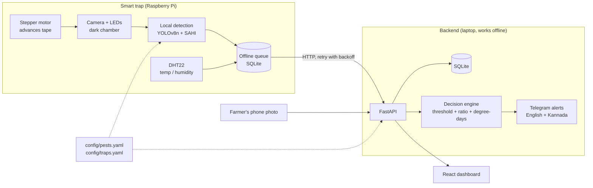

# KeetaSense - AI insect counting and pest monitoring

*Chip to Crop hackathon (Presidency University × ICAR-IIHR) - Problem Statement 1:
AI-Based Insect Counting and Pest Monitoring System.*

A smart yellow sticky trap that photographs a fresh piece of sticky tape every day,
counts **pests** (whitefly) and **beneficial predators** (Macrolophus, Nesidiocoris)
with AI, combines the counts with temperature (degree-days), and tells the farmer
one thing per trap: **SPRAY**, **RELEASE BIOCONTROL** or **WAIT** - with a plain-language
reason, in English and Kannada.

> **Status:** the software runs end to end on a laptop today, with mock hardware and
> simulated data. The AI model must still be trained on the real dataset (see
> [What is real vs simulated](#what-is-real-vs-simulated)).

---

## How it works

1. **Trap hardware.** A roll of yellow sticky tape runs like film through a dark chamber.
   Once a day a stepper motor (28BYJ-48 + ULN2003) advances it by one section; LEDs light the
   section and a Raspberry Pi camera photographs it. A DHT22 logs temperature and humidity.
2. **AI counting.** A fine-tuned **YOLOv8n** detects insects. Photos are big and insects are tiny
   (~15 px), so **SAHI** cuts each photo into overlapping 640 px tiles, detects on each tile and
   merges the boxes.
3. **Decision engine.** Averages the last 3 days of counts, computes the pest-to-predator ratio and
   accumulated **degree-days**, and decides:
   - pests ≥ action threshold **and** many pests per predator → **SPRAY**
   - pests ≥ action threshold **but** predators keeping pace → **RELEASE BIOCONTROL**
   - pests below threshold → **WAIT**

   plus a forecast: "next whitefly generation expected in about N days".
4. **Alerts.** When a trap's recommendation changes, a Telegram message is sent in English and Kannada.
5. **Dashboard.** Trends, trap status and annotated tape images; farmers without hardware can
   upload a **phone photo** of their own trap.

## Architecture



## Folder structure

| Folder | What is inside |
|---|---|
| `ml/` | dataset converter, synthetic data, tiling, training, `infer.py` (`detect()`), evaluation, Colab notebook |
| `backend/` | FastAPI app, decision engine, Telegram alerts + templates, tests |
| `edge/` | Raspberry Pi service: camera, stepper, DHT22, offline queue, `PI_SETUP.md` |
| `frontend/` | React + TypeScript + Vite + Tailwind + Recharts dashboard |
| `config/` | `pests.yaml` (classes, pest/predator mapping, thresholds), `traps.yaml` |
| `demo/` | sample tape images, `seed.py` (simulated history) |
| `scripts/` | one-command setup / start / demo for Windows (`.bat`) and Linux/Mac (`.sh`) |
| `PROGRESS.md`, `DECISIONS.md` | progress checklist; every assumption and design choice |

---

## Setup on a laptop

Needs **Python 3.12**, **Node.js 20+** and internet for the first install only (afterwards it runs offline).

**Windows**
```bat
scripts\setup.bat
```
**Linux / macOS**
```bash
bash scripts/setup.sh
```

This creates `.venv`, installs the pinned packages (CPU PyTorch), copies `.env.example` to `.env`,
installs the frontend packages and generates the sample tape images.

> No Python on Windows and no admin rights? Download `uv` (a single exe from
> https://github.com/astral-sh/uv/releases) into `.tools\uv.exe`; `setup.bat` then installs a
> portable Python 3.12 inside `.tools\` automatically.

## Run the live demo

**Windows:** `scripts\demo.bat`  **Linux/macOS:** `bash scripts/demo.sh`

It will:
1. load **14 days of simulated history** for two traps (Polyhouse, Open field),
2. start the backend on http://127.0.0.1:8000 (API docs at `/docs`),
3. start the dashboard on http://localhost:5173,
4. start the edge service in **mock mode**: every 20 seconds it "advances the tape", takes the next
   sample image from `demo/sample_tape/`, counts insects, reads a simulated DHT22 and syncs.

In the dashboard, switch **Live on** (top right). Open the **Polyhouse trap**: a new point appears
every 20 s and the recommendation changes as the sample story plays (WAIT → SPRAY → RELEASE BIOCONTROL → WAIT).
Try **Phone check** with any image from `demo/sample_tape/`.

Only backend + dashboard (no edge, no reset): `scripts\start.bat` or `bash scripts/start.sh`.

### Manual commands (what the scripts run)

```bash
python -m demo.seed --reset                        # simulated history
python -m uvicorn backend.main:app --port 8000     # backend
npm --prefix frontend run dev                      # dashboard
python -m edge.main --demo                         # mock trap, one cycle per 20 s
```
(Use `.venv\Scripts\python.exe` on Windows or `.venv/bin/python` on Linux/Mac, or activate the venv first.)

## Tests

```bash
python -m pytest
```
50 tests: dataset converter, demo detector, evaluation maths, every decision-engine rule,
every API endpoint, and the edge service (offline queue, backoff, stepper sequence).
Frontend type-check + build: `npm --prefix frontend run build`.

---

## Train the AI model (Google Colab, free GPU)

1. Download the **Yellow Sticky Traps** dataset (Wageningen University & Research, CC0, ~800 MB):
   https://data.4tu.nl/articles/_/12707066/1 - or a Kaggle mirror with
   `python -m ml.download_kaggle --dataset <owner>/<name>` (needs your `kaggle.json`).
2. Open `ml/train_colab.ipynb` in Google Colab, choose **Runtime → T4 GPU**, and run the cells. They:
   - `python -m ml.convert_dataset` - detect VOC/YOLO labels, map WF/MR/NC via `pests.yaml`,
     stratified 70/15/15 split (seed 42)
   - `python -m ml.tile_dataset` - cut 640 px training tiles so tiny insects stay visible
   - `python -m ml.train --data ml/data/yolo_tiles/data.yaml --epochs 100 --device 0`
   - `python -m ml.evaluate --data ml/data/yolo/data.yaml --weights ml/weights/best.pt`
3. Download `best.pt` and the report, put `best.pt` in `ml/weights/`, restart the backend.
   The "Demo detector" badge disappears and the dashboard shows "AI model (YOLOv8 + SAHI)".

Locally you can test the whole ML pipeline on synthetic data in a few minutes:
```bash
python -m ml.synthetic --n 80
python -m ml.convert_dataset --raw ml/data/synthetic_raw --out ml/data/synthetic_yolo
python -m ml.train --data ml/data/synthetic_yolo/data.yaml --epochs 2 --imgsz 320 --device cpu --weights-out ml/weights/synthetic_smoke_test.pt
python -m ml.evaluate --data ml/data/synthetic_yolo/data.yaml --weights ml/weights/synthetic_smoke_test.pt
python -m ml.infer demo/sample_tape/tape_05.jpg
```

## Camera-domain test (printed images under the trap camera)

On stage the camera photographs **printed** test images (or real tape) under LEDs. Printing and the
camera add blur, colour cast and perspective, so check how much the counts change:

1. `python -m ml.camera_test prepare --n 10` - copies the 10 test images with the most insects to
   `ml/data/camera_test/originals/` (needs the converted real dataset).
2. Print each one in colour, one per page, filling the page.
3. Put each print in the trap chamber and photograph it with the Pi camera
   (`python -m edge.tests_hw.test_camera --out ml/data/camera_test/photos/img_12_cam.jpg`) or a phone.
   The original's file name must appear inside the photo's name (`img_12.jpg` -> `img_12_cam.jpg`).
4. `python -m ml.camera_test run` - runs the detector on every original/photo pair and writes
   `ml/reports/camera_test.md`: mean count difference (absolute, signed, %) for pests and predators,
   per class and per image, plus error against the labels.

Run it with the trained model installed - with the demo detector the numbers mean nothing.

## Raspberry Pi

See **[edge/PI_SETUP.md](edge/PI_SETUP.md)**: parts list, wiring tables for the ULN2003 stepper driver
and the DHT22, install steps, tape-advance calibration, and running as a `systemd` service.
On the Pi set `MOCK_HARDWARE=0` and `BACKEND_URL=http://<laptop-ip>:8000` in `.env`.

## Configuration

| File | What to change |
|---|---|
| `config/pests.yaml` | insect classes, **pest vs predator** mapping, dataset label aliases, decision thresholds (all marked *PLACEHOLDER - confirm with IIHR mentor*) |
| `config/traps.yaml` | trap ids, names, locations, target pest, simulated flag |
| `.env` | paths, detector settings (SAHI tile size/overlap, confidence), Telegram token + chat id, edge pins and timings |
| `backend/alert_templates.yaml` | English and Kannada alert text (**a Kannada speaker must verify it**) |

**Telegram:** create a bot with @BotFather, put the token in `TELEGRAM_BOT_TOKEN` and your chat id in
`TELEGRAM_CHAT_ID`. Without them, alerts are written to the backend log and shown in the dashboard as
"logged" - nothing fails.

## API

| Method | Path | Purpose |
|---|---|---|
| POST | `/api/sections` | tape image + trap_id (+ timestamp) → detect, store, return counts + annotated image URL + decision |
| POST | `/api/climate` | temperature / humidity reading |
| POST | `/api/phone-check` | farmer photo (+ days exposed) → counts + recommendation |
| GET | `/api/traps` | all traps with latest counts, climate, decision |
| GET | `/api/traps/{id}/history` | sections, daily climate + degree-days, decision history |
| GET | `/api/traps/{id}/decision` | current recommendation |
| GET | `/api/summary` | numbers for the dashboard cards |
| GET | `/api/alerts` | recent alerts |
| GET | `/api/health` | status, detector mode, Telegram mode |

Images are served from `/media/...`. Interactive docs: http://127.0.0.1:8000/docs.

---

## What is real vs simulated

| Part | Status |
|---|---|
| Dataset converter, tiling, training, SAHI inference, evaluation code | **Real**, tested end to end on synthetic data |
| Trained insect model (`ml/weights/best.pt`) | **Not trained yet** - must be trained on Colab with the real dataset |
| Insect counts in the demo | **Demo detector** (classical blob counting tuned to synthetic images), badge "Demo detector" everywhere |
| Tape images in `demo/sample_tape/` and seeded history | **Synthetic** drawings, not photos; badge "Simulated data" |
| Temperature / humidity in the demo | **Simulated** (daily cycle + noise) |
| Stepper motor, camera, DHT22 in the demo | **Mocked** (log only / sample images); real drivers written for the Pi but **not tested on hardware** |
| Decision engine, degree-days, API, database, offline queue, dashboard, alerts | **Real** and covered by tests |
| Thresholds (action threshold, spray ratio, base temperature, DD per generation) | **Placeholders** - confirm with the IIHR mentor |
| Kannada alert text | **Machine-drafted** - a native speaker must check it |
| Telegram sending | Real code; runs in "log only" mode until a token is added |

### Measured metrics

Only numbers produced by `ml/evaluate.py` are reported; reports are in `ml/reports/`.
So far **all measurements are on synthetic data** and only prove the pipeline runs. For example, the
YOLOv8n trained for 40 CPU epochs on 56 synthetic images scores perfectly on the 12 synthetic test
images (`eval_synthetic_40ep_yolo_sahi.md`) because the synthetic insects are trivially easy - this says
**nothing** about real insects. **No accuracy figure for real traps exists yet**: it will come from
running `ml.evaluate` on the real test split after training.

---

## Troubleshooting

| Problem | Fix |
|---|---|
| Dashboard says "Backend not reachable" | Start the backend (`scripts\start.bat`); check http://127.0.0.1:8000/api/health |
| `python` not found on Windows | Install Python 3.12 (tick "Add to PATH") or use the portable `uv` option above |
| Port 8000 or 5173 already in use | Close the old window/process, or change `--port` and `VITE_API_BASE` in `frontend/.env` |
| Every request takes ~2 s on Windows | Use `127.0.0.1` instead of `localhost` in `BACKEND_URL` / `VITE_API_BASE` |
| "DEMO DETECTOR" warning in the log | Expected until `ml/weights/best.pt` exists |
| Kannada text shows as `ಕ...` in the console | Run via the scripts (they set `PYTHONUTF8=1`) |
| Edge says "Backend unreachable … kept offline" | Fine - items stay in `edge/data/queue.db` and are sent when the backend is back |
| Demo shows old data | `python -m demo.seed --reset` |
| `npm ci` fails | Delete `frontend/node_modules` and run `npm --prefix frontend install` |
| On the Pi: `RuntimeError` from DHT22 | Normal occasionally; the code retries. Check wiring and the 10 kΩ pull-up if it never works |
| On the Pi 5: `RPi.GPIO` errors | Install `rpi-lgpio` (in `edge/requirements-pi.txt`) instead of `RPi.GPIO` |

## Licence and data

Dataset: Nieuwenhuizen et al., *Raw data from Yellow Sticky Traps with insects for training of deep
learning Convolutional Neural Network for object detection*, Wageningen University & Research, CC0,
DOI 10.4121/uuid:8b8ba63a-1010-4de7-a7fb-6f9e3baf128e.
